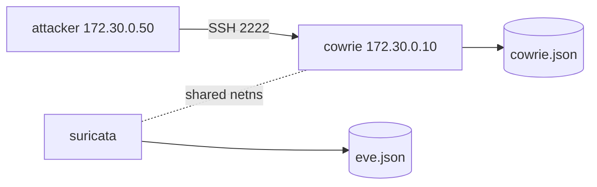

# Phase 2: Cowrie + Suricata

- Compose project honeylab, network honeynet 172.30.0.0/24, no ports published to the host
- Cowrie (SSH honeypot, port 2222) with JSON logs in a named volume
- Suricata 7.0.11 sharing Cowrie network namespace (network_mode: service:cowrie), eve.json in a named volume
- Attacker container (nmap, hydra, sshpass) behind the attack profile
- Validation: nmap, SSH login and hydra from the attacker; events seen in cowrie.json and eve.json

